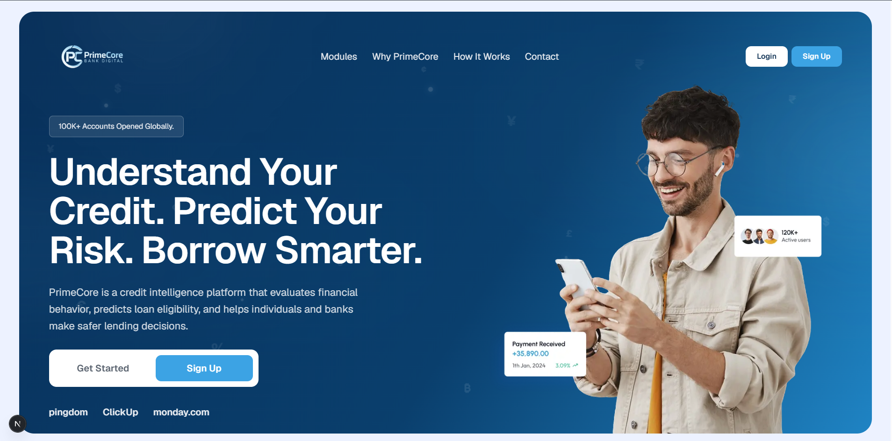
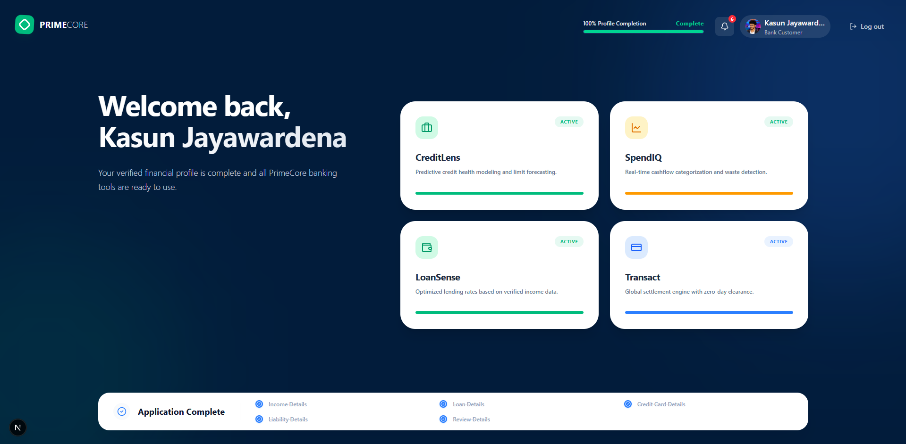
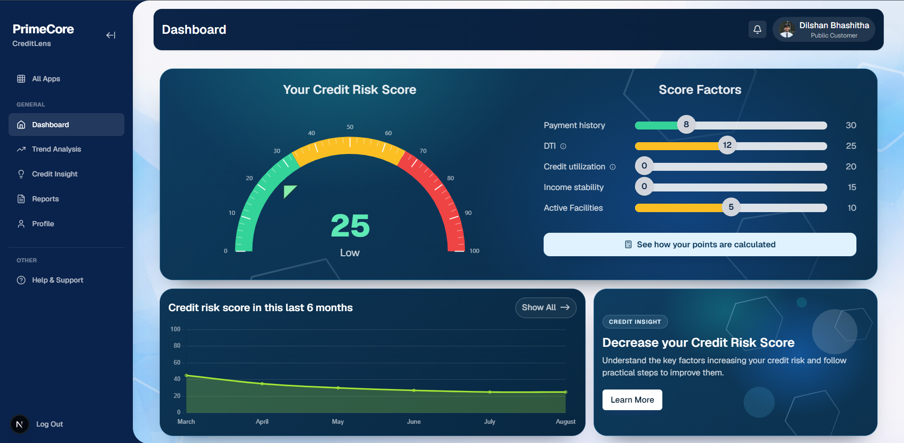
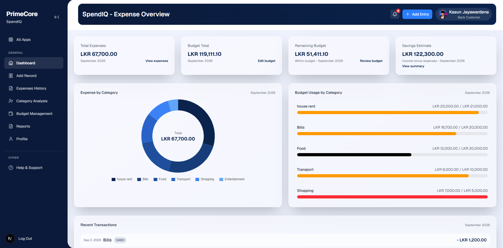
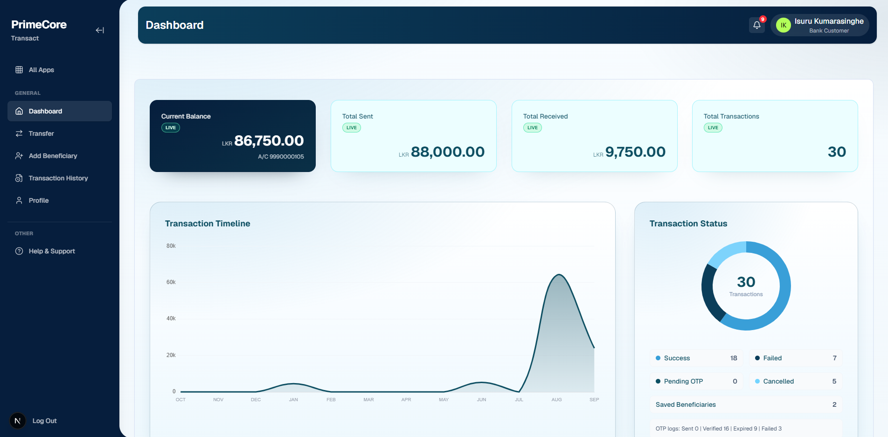
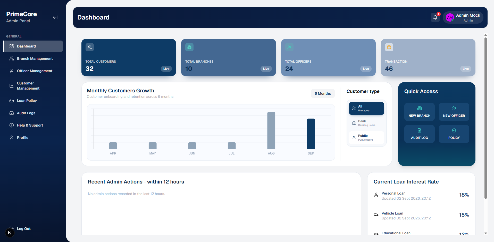
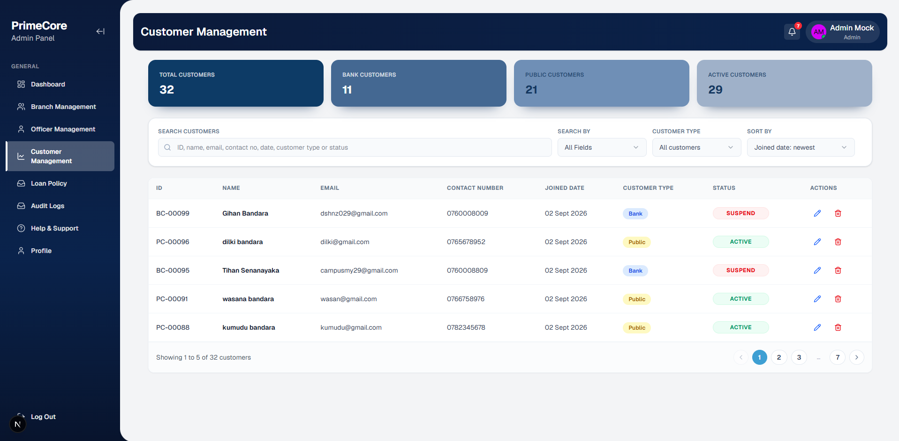
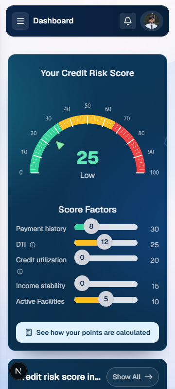
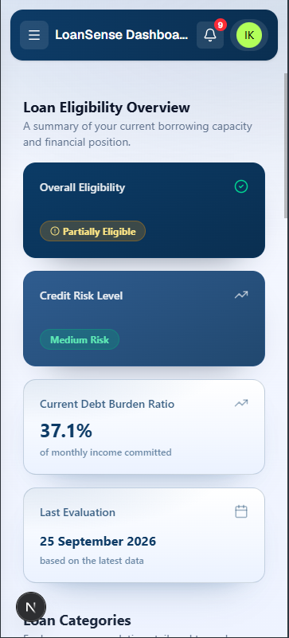

# PrimeCore Bank Web App — Frontend

[Live application](https://bank-web-app-theta.vercel.app/) · [Backend repository](https://github.com/Metaminds-BankWebApp/Bank-Web-App-backend) · [Frontend setup guide](frontend/README.md)

PrimeCore brings everyday banking, spending insights, credit health, and loan eligibility into one place. It gives customers tools to understand their finances while helping bank officers and administrators manage customer services and banking operations.

This repository contains the Next.js frontend. The backend is maintained separately in the linked repository.



## Explore the project

- [User roles](#who-is-it-for)
- [SpendIQ](#spendiq-understand-your-spending), [CreditLens](#creditlens-keep-track-of-credit-health), [LoanSense](#loansense-explore-borrowing-options), and [Transact](#transact-manage-everyday-transfers)
- [Screenshots](#screenshots)
- [Technology](#technology)
- [Run locally](#run-locally)
- [Repository structure](#repository-structure)

## Who is it for?

| User | What they can do |
| --- | --- |
| Public customers | Explore spending and credit health tools and complete a customer application. |
| Bank customers | Manage spending, review credit health, explore loan eligibility, and make transfers. |
| Bank officers | Onboard customers, review financial information, and manage customer work queues. |
| Administrators | Manage users, branches, bank officers, loan policies, and support requests. |

## SpendIQ: understand your spending

SpendIQ helps customers see where their money goes and plan their spending.

- Record financial activity and review transaction history.
- Organize spending by category and inspect the transactions behind each category.
- View spending summaries and charts to understand spending patterns.
- Set monthly category budgets and distribute a total budget across categories.
- Compare spending with budget limits and see warnings when categories approach or exceed their limits.
- Filter past activity and download spending reports for personal records.

## CreditLens: keep track of credit health

CreditLens brings credit risk information into a dedicated dashboard with explanations and supporting details.

- View credit risk scores and risk levels.
- Explore the factors contributing to the assessment.
- Review positive financial behaviors alongside areas that need attention.
- Follow credit risk trends over time.
- Read financial insights and tips to understand opportunities for improvement.
- Open a detailed credit report with financial summaries and a breakdown of risk points.

## LoanSense: explore borrowing options

LoanSense helps bank customers understand their eligibility for personal, vehicle, education, and housing loans.

- View overall eligibility and results for each loan category.
- Review recommended maximum loan amounts and estimated monthly repayments.
- Explore available interest rate and repayment period information.
- See how income, existing repayments, and credit commitments affect borrowing capacity.
- Read the reasons behind eligibility results.
- Review previous eligibility assessments and filter them by loan type or date.

## Transact: manage everyday transfers

Transact gives bank customers a workspace for sending money and reviewing account activity.

- Make transfers through a guided transfer flow.
- Use one-time password verification during transfers.
- Add and manage beneficiaries for future payments.
- Review transaction history and find previous payments.
- Export transaction records for reference.

## Bank officer workspace

Bank officers have a dedicated workspace for customer onboarding and financial reviews.

- Find customers and open their records.
- Register customers through a step-by-step onboarding process.
- Capture personal details, financial information, loans, credit cards, and other liabilities.
- Work through credit information request and retrieval steps during onboarding.
- Review customer credit information and evaluations.
- Organize pending customer work through a work queue.
- View transaction records, history, notifications, and support conversations.

## Administration

Administrators can oversee the people, branches, and policies used across the platform.

- Manage user accounts and bank officer records.
- Add and manage bank branches.
- Configure policies for personal, vehicle, education, and housing loans.
- Review audit logs to follow recorded activity.
- Handle support conversations and update their status.
- Access an administrative dashboard, notifications, and profile settings.

## Account access and personal settings

- Customer registration and sign-in.
- One-time password verification and password recovery.
- Dedicated dashboards based on the user's account role.
- Profile editing and profile image customization.
- Light and dark themes.
- Layouts that adapt to different screen sizes.

## Notifications and support

Customers and staff can keep up with account activity and ask for help within their workspace.

- View notifications in a dedicated notifications area.
- Open help and support pages from banking modules.
- Submit support requests with a subject, category, and message.
- Follow support conversations and reply to messages.

Feature availability depends on the user's role and account information. Authentication and live banking data require the connected backend service.

## Screenshots

These desktop and mobile screenshots were captured on 25 September 2026. They illustrate the interface at that time; displayed balances, counts, and assessments are snapshot values.

### Customer app hub

The customer workspace brings CreditLens, SpendIQ, LoanSense, and Transact together with profile completion status.



### CreditLens

A credit risk overview with score factors, historical trends, and credit insights.



### SpendIQ

Expense totals, category breakdowns, monthly budgets, and recent activity in one dashboard.



### Transact

Account balance, transfer totals, transaction trends, and payment status summaries.



### Administration

An overview of customers, branches, officers, customer growth, and loan interest rates.



Customer search, filtering, account types, and status management.



### Mobile layouts

CreditLens and LoanSense adapt their dashboards for smaller screens.

<table>
  <tr>
    <th>CreditLens</th>
    <th>LoanSense</th>
  </tr>
  <tr>
    <td></td>
    <td></td>
  </tr>
</table>

## Technology

| Area | Tools |
| --- | --- |
| Application | Next.js 16.1.6, React 19.2.3, TypeScript |
| Styling and UI | Tailwind CSS 4, Radix UI, Lucide icons, Framer Motion |
| State and API requests | Zustand, Axios |
| Charts | Chart.js, React Chart.js 2, Recharts |
| Themes | next-themes |
| Frontend hosting | Vercel |

## Run locally

Install a supported Node.js LTS release compatible with Next.js 16 and npm. From the repository root:

```bash
cd frontend
npm ci
```

Create `frontend/.env.local` with the backend API base URL:

```dotenv
NEXT_PUBLIC_API_BASE_URL=http://localhost:8080/api
```

Start the backend using the instructions in the [backend repository](https://github.com/Metaminds-BankWebApp/Bank-Web-App-backend), then start the frontend from `frontend/`:

```bash
npm run dev
```

Open [localhost:3000](http://localhost:3000). Sign-in and data-driven features require a running backend and a configured account. See the [frontend guide](frontend/README.md) for configuration, scripts, API integration, and deployment details.

## Repository structure

```text
bank-web-app/
├── README.md                 # Project overview and screenshot gallery
├── docs/
│   └── screenshots/           # Images referenced by this README
└── frontend/
    ├── app/                  # App Router pages, layouts, and role workspaces
    ├── components/           # Shared frontend components
    ├── config/               # Environment configuration
    ├── public/               # Assets served by the application
    ├── src/
    │   ├── api/              # API client, endpoint definitions, and wrappers
    │   ├── components/       # UI and feature components
    │   ├── store/            # Authentication and application state
    │   └── types/            # API DTOs and shared types
    ├── package.json
    └── README.md             # Frontend development guide
```

### Screenshot file location

README images are stored in `docs/screenshots/` with descriptive filenames and repository-relative links. They do not depend on the original Windows or OneDrive paths, so moving or cloning the repository keeps the images accessible. Add future README screenshots to this folder and reference them as `docs/screenshots/<filename>.png` from this README or `../docs/screenshots/<filename>.png` from `frontend/README.md`.
